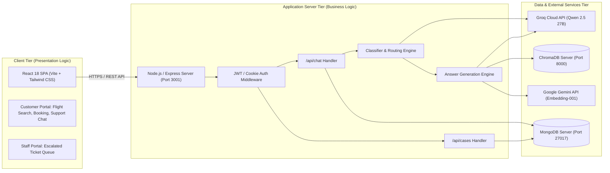
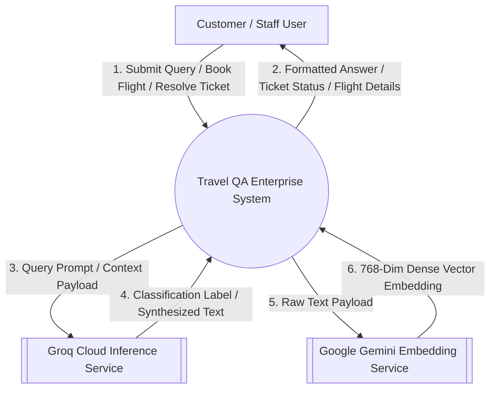
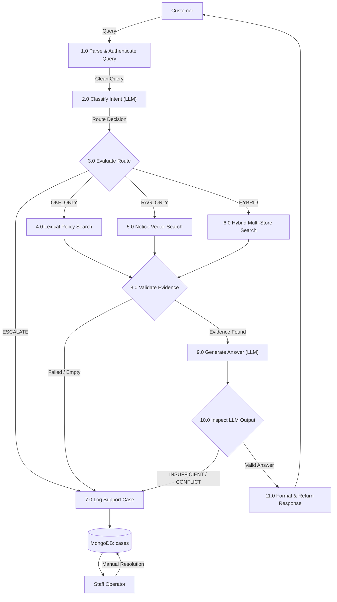
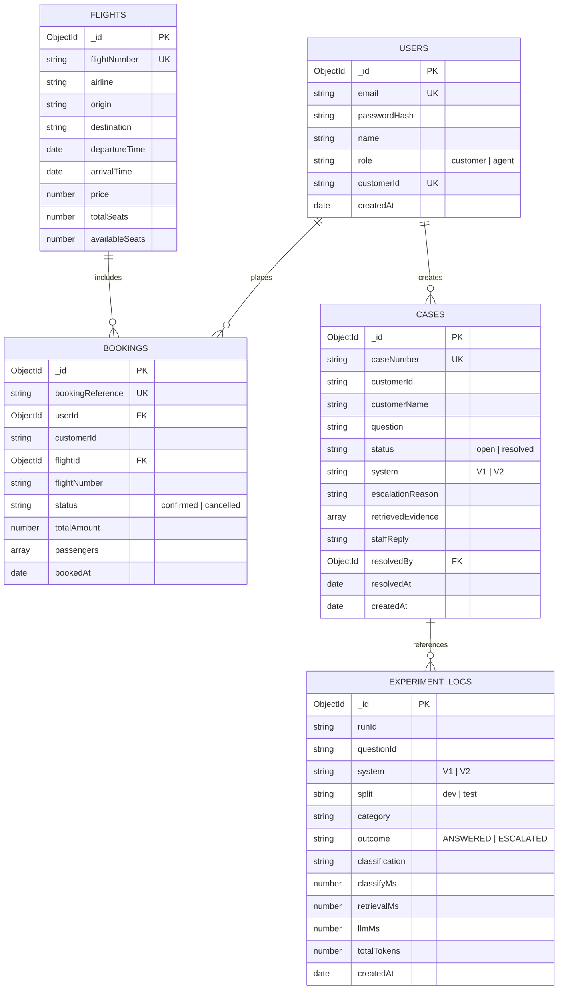

# Mini Project Report
on
# Classify-Then-Retrieve: LLM-Based Question Routing Between Curated Policies and Event Data for Travel Support QA

**Submitted for partial fulfillment of award of**  
**BACHELOR OF TECHNOLOGY degree**  
**In**  
**Computer Science & Engineering**

**By:**  
Yash (Roll No: [Roll No])  
[Student Name 2] (Roll No: [Roll No])  
[Student Name 3] (Roll No: [Roll No])  
[Student Name 4] (Roll No: [Roll No])  

**Under the Supervision of:**  
[Supervisor Name]  
([Designation])  

---

**ABES ENGINEERING COLLEGE, GHAZIABAD**  
**AFFILIATED TO**  
**Dr. A P J ABDUL KALAM TECHNICAL UNIVERSITY, LUCKNOW**  
**November 2026**

---

## STUDENT’S DECLARATION

We hereby declare that the work being presented in this report entitled **“Classify-Then-Retrieve: LLM-Based Question Routing Between Curated Policies and Event Data for Travel Support QA”** is an authentic record of our own work carried out under the supervision of **[Supervisor Name]**, Department of Computer Science & Engineering, ABES Engineering College, Ghaziabad.

The matter embodied in this report has not been submitted by us for the award of any other degree.

**Dated:** November 2026  
**Signature of student(s):**  
1. Yash (Roll No: ..................)  
2. [Student 2] (Roll No: ..................)  
3. [Student 3] (Roll No: ..................)  
4. [Student 4] (Roll No: ..................)  

**Department:** Computer Science & Engineering  

This is to certify that the above statement made by the candidates is correct to the best of my knowledge.

| Signature of HOD | Signature of Supervisor |
|---|---|
| **Prof. (Dr.) Pankaj Kumar Sharma** <br> Head, Department of Computer Science & Engineering <br> ABES Engineering College, Ghaziabad <br> Date: ............................ | **[Supervisor Name]** <br> [Designation] <br> Department of Computer Science & Engineering <br> ABES Engineering College, Ghaziabad <br> Date: ............................ |

---

## CERTIFICATE

This is to certify that project report entitled **“Classify-Then-Retrieve: LLM-Based Question Routing Between Curated Policies and Event Data for Travel Support QA”** which is submitted by **Yash ([Roll No]) and group members** in partial fulfilment of the requirement for the award of the degree of **B. Tech. in Computer Science & Engineering** of **Dr A.P.J. Abdul Kalam Technical University, Lucknow**, is a record of the candidate's own work carried out under my supervision. The matter embodied in this thesis is original and has not been submitted for the award of any other degree.

<br><br>
**Signature of Supervisor**  
**Name:** [Supervisor Name]  
**Designation:** [Designation]  
**Department:** Computer Science & Engineering  
**ABES Engineering College, Ghaziabad**  

---

## ACKNOWLEDGEMENT

It gives us a great sense of pleasure to present the report of the B. Tech Mini Project undertaken during B. Tech. Final Year. We owe special debt of gratitude to **[Supervisor Name]**, Department of Computer Science & Engineering, ABESEC Ghaziabad for constant support and guidance throughout the course of our work. Sincerity, thoroughness, and perseverance have been a constant source of inspiration for us. It is through these cognizant efforts that our endeavors have seen the light of day.

We also take the opportunity to acknowledge the contribution of **Prof. (Dr.) Pankaj Kumar Sharma**, Head, Department of Computer Science & Engineering, ABESEC Ghaziabad for full support and administrative assistance during the development of the project.

We also do not want to miss the opportunity to acknowledge the contribution of all faculty members of the department for their kind assistance and cooperation during the development of our project. Last but not the least, we acknowledge our peers and families for their encouragement and support in the completion of the project.

| | |
|---|---|
| Signature: ....................................... <br> Name: Yash <br> Roll No: [Roll No] <br> Date: November 2026 | Signature: ....................................... <br> Name: [Student Name 2] <br> Roll No: [Roll No] <br> Date: November 2026 |
| Signature: ....................................... <br> Name: [Student Name 3] <br> Roll No: [Roll No] <br> Date: November 2026 | Signature: ....................................... <br> Name: [Student Name 4] <br> Roll No: [Roll No] <br> Date: November 2026 |

---

## ABSTRACT

Automated customer support in travel operations requires answering inquiries spanning two fundamentally distinct knowledge modalities: static, highly structured organizational policies (e.g., baggage limits, visa requirements, refund rules) and dynamic, unstructured operational notices (e.g., flight delays, gate reassignments, baggage incident logs). Standard Retrieval-Augmented Generation (RAG) architectures index both modalities into a shared dense vector database, which creates cross-source ranking interference, context dilution, and hallucination on out-of-scope inquiries.

In this project, we design, implement, and benchmark a full-stack automated Travel Support Question Answering platform comparing two architectural approaches: a standard undifferentiated single-index RAG baseline (**V1**) and an intelligent classify-then-retrieve architecture (**V2**). V2 leverages a zero-shot LLM routing prompt to categorize incoming inquiries into `OKF_ONLY`, `RAG_ONLY`, `HYBRID`, or `ESCALATE` before dispatching queries to targeted retrieval engines (in-memory keyword policy matching or vector notice retrieval) with an unanswerable query escalation pipeline. The system is wrapped in an interactive web application built with React, Vite, Tailwind CSS, Node.js, Express, ChromaDB, and MongoDB, supporting role-based access control, flight search, booking workflows, and a staff escalation dashboard.

Benchmarked on a frozen synthetic test set of 56 travel questions across 7 balanced categories using Qwen 2.5 27B (`qwen/qwen3.8-27b`) and Gemini embeddings, V1 achieved 33/56 (58.9%) overall correctness and V2 achieved 30/56 (53.6%). In sensitivity analysis excluding an intentionally outdated policy category (48 questions), both architectures achieved identical overall correctness (26/48, 54.2%), while V2 reduced the wrong-answer rate from 39.6% (19/48) to 29.2% (14/48) by safely escalating unanswerable inquiries to human operators. Furthermore, V2 reduced mean token usage from 947 to 740 tokens/query and maintained competitive median latency (934 ms vs. 1070 ms).

**Keywords:** Retrieval-Augmented Generation, Question Routing, Large Language Models, Customer Support QA, Vector Databases, ChromaDB, Travel Operations.

---

## TABLE OF CONTENTS

- **DECLARATION** ................................................................................................. ii
- **CERTIFICATE** .................................................................................................... iii
- **ACKNOWLEDGEMENTS** .................................................................................. iv
- **ABSTRACT** ........................................................................................................ v
- **LIST OF TABLES** ................................................................................................ vii
- **LIST OF FIGURES** ............................................................................................. viii
- **LIST OF ABBREVIATIONS** ................................................................................. ix

### CHAPTER 1: INTRODUCTION ........................................................................... 1
- 1.1 Problem Introduction ....................................................................................... 1
- 1.2 Motivation ........................................................................................................ 2
- 1.3 Project Objective ............................................................................................. 3
- 1.4 Scope of the Project ........................................................................................ 4
- 1.5 Related Previous Work ..................................................................................... 5
- 1.6 Organization of the Report ............................................................................... 6

### CHAPTER 2: LITERATURE SURVEY & SRS ......................................................... 7
- 2.1 Literature Survey ............................................................................................. 7
- 2.2 Software Requirement Specification (SRS) ........................................................ 9
  - 2.2.1 Product Perspective .................................................................................... 9
  - 2.2.2 System Interfaces ...................................................................................... 10
  - 2.2.3 Hardware Interfaces ................................................................................... 10
  - 2.2.4 Software Interfaces .................................................................................... 11
  - 2.2.5 Communications Interfaces ........................................................................ 11
  - 2.2.6 Memory & Storage Constraints ................................................................... 11
  - 2.2.7 Operations ................................................................................................. 12
  - 2.2.8 Site Adaptation Requirements .................................................................... 12
  - 2.2.9 Product Functions ..................................................................................... 12
  - 2.2.10 User Characteristics ................................................................................. 13
  - 2.2.11 Constraints ............................................................................................... 13
  - 2.2.12 Assumptions and Dependencies ............................................................... 14
- 2.3 Use Case Model & Scenarios ........................................................................... 14

### CHAPTER 3: SYSTEM DESIGN AND METHODOLOGY ...................................... 17
- 3.1 Architectural Variants: V1 vs. V2 .................................................................... 17
- 3.2 3-Tier System Architecture ............................................................................. 19
- 3.3 Data Flow Diagrams (DFD) .............................................................................. 21
- 3.4 Entity-Relationship (ER) & Database Schema ................................................... 23
- 3.5 Core Algorithms ............................................................................................... 25
  - 3.5.1 Zero-Shot Classification Routing Algorithm ................................................. 25
  - 3.5.2 Lexical OKF Keyword Matching Algorithm ................................................... 26
  - 3.5.3 Answer Generation and Escalation Contract ............................................... 27

### CHAPTER 4: IMPLEMENTATION AND RESULTS ............................................... 29
- 4.1 Software and Hardware Environment ............................................................... 29
- 4.2 Implementation Details .................................................................................... 30
- 4.3 Test Set Protocol & Benchmark Execution ........................................................ 32
- 4.4 Results & Comparative Performance ............................................................... 33
  - 4.4.1 Primary Benchmark Findings ..................................................................... 33
  - 4.4.2 Sensitivity Analysis (Excluding Stale Policy) ............................................... 34
  - 4.4.3 Per-Category Analysis ................................................................................ 35
  - 4.4.4 Classification Confusion Matrix ................................................................. 36
  - 4.4.5 Latency and Token Benchmark ................................................................... 37

### CHAPTER 5: CONCLUSION & FUTURE DIRECTIONS ........................................ 39
- 5.1 Performance Evaluation Summary ................................................................... 39
- 5.2 Comparison with State-of-the-Art Approaches .................................................. 40
- 5.3 Practical Implications ....................................................................................... 40
- 5.4 Limitations & Future Directions ........................................................................ 41

### APPENDIX A: PROMPT DEFINITIONS & API CONTRACTS ................................. 43
### APPENDIX B: HARDWARE & REPRODUCIBILITY GUIDE .................................... 45
### REFERENCES .................................................................................................... 47

---

## LIST OF TABLES

| Table No. | Title | Page No. |
|---|---|---|
| Table 2.1 | Software Component and Dependency Specification | 11 |
| Table 2.2 | Use Case Scenario: Ask Support Question with Dynamic Routing | 15 |
| Table 2.3 | Use Case Scenario: Staff Case Resolution | 16 |
| Table 3.1 | MongoDB Database Schema Definitions | 24 |
| Table 4.1 | Primary Evaluation Results (All 56 Frozen Test Questions) | 33 |
| Table 4.2 | Sensitivity Analysis Excluding Stale Policy Category (48 Questions) | 34 |
| Table 4.3 | Category-by-Category Performance Breakdown (8 Questions Each) | 35 |
| Table 4.4 | V2 Question Classification Confusion Matrix (56 Test Questions) | 36 |
| Table 4.5 | 3-Repetition Latency & Token Efficiency Benchmark | 37 |

---

## LIST OF FIGURES

| Figure No. | Title | Page No. |
|---|---|---|
| Figure 3.1 | Dual Architecture Overview: V1 Baseline vs. V2 Classify-Then-Retrieve | 18 |
| Figure 3.2 | 3-Tier System Architecture Diagram | 20 |
| Figure 3.3 | Level 0 Context Data Flow Diagram | 21 |
| Figure 3.4 | Level 1 Data Flow Diagram (V2 Pipeline & Escalation) | 22 |
| Figure 3.5 | Entity-Relationship (ER) Diagram for Travel QA Application | 23 |
| Figure 3.6 | Activity Diagram for Customer Chat and Escalation Lifecycle | 28 |

---

## LIST OF ABBREVIATIONS

| Abbreviation | Expansion |
|---|---|
| **API** | Application Programming Interface |
| **BM25** | Best Matching 25 (Information Retrieval Ranking) |
| **ChromaDB** | Open-source Embedding Vector Database |
| **Cosine Sim** | Cosine Similarity Metric ($1 - \text{distance}$) |
| **DFD** | Data Flow Diagram |
| **ER** | Entity-Relationship |
| **ESM** | ECMAScript Modules |
| **HNSW** | Hierarchical Navigable Small World (Vector Indexing) |
| **HTTP / REST** | Hypertext Transfer Protocol / Representational State Transfer |
| **JSON** | JavaScript Object Notation |
| **JWT** | JSON Web Token |
| **LLM** | Large Language Model |
| **MongoDB** | Document-Oriented NoSQL Database |
| **OKF** | Operational Knowledge File (Curated Markdown Policy) |
| **QA** | Question Answering |
| **RAG** | Retrieval-Augmented Generation |
| **RBAC** | Role-Based Access Control |
| **RQ** | Research Question |
| **SRS** | Software Requirement Specification |
| **UI / UX** | User Interface / User Experience |
| **V1** | Undifferentiated Combined-Index RAG Baseline System |
| **V2** | Classify-Then-Retrieve Routing QA System |
| **YAML** | YAML Ain't Markup Language |

---

# CHAPTER 1
# INTRODUCTION

## 1.1 Problem Introduction
In enterprise travel operations, passenger inquiries require synthesizing two distinct knowledge modalities:
1. **Curated Policy Documentation:** Static, legally verified contractual rules governing airline ticketing, baggage dimensions, pet carriage, cancellation penalties, and consular visa restrictions.
2. **Dynamic Operational Notices:** High-velocity, situational, and event-specific status updates regarding flight delays, gate reassignments, maintenance groundings, and baggage lost-and-found records.

Standard customer-facing chatbots utilizing Retrieval-Augmented Generation (RAG) typically pool all organizational documents into a single dense vector index. While straightforward to build, single-index RAG systems suffer from two chronic failure modes in customer service:
- **Cross-Source Ranking Interference:** Queries asking for operational facts (e.g., *"Is flight VJ-202 delayed?"*) may inadvertently retrieve dense policy text that dilutes context or pushes the actual operational record outside the prompt window. Conversely, policy queries (e.g., *"Can I cancel a non-refundable ticket?"*) may match incident logs mentioning cancellations on unrelated flights.
- **Hallucination on Unanswerable Inquiries:** When passengers ask out-of-scope, ambiguous, or contradictory questions, dense vector search retrieves the "nearest" chunks regardless of topical sufficiency. The downstream LLM frequently fabricates authoritative-sounding answers instead of safely escalating to human support.

## 1.2 Motivation
Travel customer support is high-stakes: providing incorrect visa rules or erroneous cancellation fee waivers directly causes financial penalties, stranded passengers, and legal liabilities. In an enterprise customer service department, **a wrong answer is substantially more damaging than an honest escalation to a human agent**.

Traditional keyword routing systems lack semantic flexibility, while naive vector RAG lacks modality boundaries. If an LLM can classify customer intent *before* search, the retrieval pipeline can query dedicated knowledge repositories (e.g., lexical matchers for structured policies and vector indices for operational alerts) or bypass retrieval entirely to escalate unanswerable queries. Evaluating whether an explicit "classify-then-retrieve" architecture improves answer accuracy, lowers hallucination, and reduces operational token cost is the central motivation of this study.

## 1.3 Project Objective
The key objectives of this project are:
1. **Design and Implement Two Architectural Variants:**
   - **V1 (RAG Baseline):** An undifferentiated combined ChromaDB collection indexing both policy documents and operational notices with top-3 cosine similarity retrieval.
   - **V2 (Classify-First Pipeline):** A zero-shot classification router categorizing inquiries into `OKF_ONLY`, `RAG_ONLY`, `HYBRID`, or `ESCALATE`, executing targeted retrieval from dedicated sub-stores and escalating unanswerable inquiries.
2. **Develop an Interactive Full-Stack Travel Application Shell:** Build an end-to-end customer travel portal featuring JWT-based role authentication (customer and support agent), real-time flight search, demo booking flows, an interactive customer chat assistant, and a staff case escalation management dashboard.
3. **Rigorous Empirical Evaluation:** Benchmark both architectures on an unseen, frozen test dataset of 56 travel questions across 7 categories using Qwen 2.5 27B (`qwen/qwen3.8-27b`) and Gemini embeddings, measuring overall correctness, wrong-answer rate, unnecessary escalation rate, token efficiency, and end-to-end latency across multiple repetitions.

## 1.4 Scope of the Project
- **Within Scope:**
  - Automated question classification from question text alone.
  - Multi-store targeted retrieval (lexical matching for curated policies, vector retrieval for operational notices).
  - Multi-factor escalation pipeline (`INSUFFICIENT`, `CONFLICT`, `CLASSIFIER_ESCALATE`, `NO_OKF_MATCH`, `NO_RAG_MATCH`).
  - Production web application with dual roles (`customer` and `agent`), flight search, mock bookings, and support ticket resolution.
  - Strict frozen-test evaluation with key-fact substring scoring and human audit review.
- **Outside Scope:**
  - Fine-tuning language models or embedding models.
  - Live third-party airline GDS / NDC API integration (synthetic travel database is used).
  - Usability or ergonomic testing of the frontend web application (the UI serves as an operational container and is not evaluated).

## 1.5 Related Previous Work
Retrieval-Augmented Generation (Lewis et al., 2020) demonstrated that non-parametric dense vector memories dramatically reduce parametric knowledge hallucinations. Subsequent work in open-domain QA demonstrated that multi-task routing and adaptive retrieval can prevent unnecessary search overhead. In conversational customer service, recent architectures explore hybrid keyword-dense retrieval (BM25 + dense bi-encoders) and self-reflective query routing (Self-RAG). However, comparative empirical benchmarks assessing zero-shot classification routing between static policy files and dynamic operational events under strict corporate escalation contracts have remained underexplored.

## 1.6 Organization of the Report
The remainder of this report is organized as follows:
- **Chapter 2** provides the literature survey and detailed Software Requirement Specification (SRS) along with use-case modeling.
- **Chapter 3** presents the system architecture, mathematical formulations, database schemas, and data flow diagrams.
- **Chapter 4** describes implementation technologies, experimental benchmarking protocols, and detailed quantitative results across primary, sensitivity, category, and timing dimensions.
- **Chapter 5** concludes with performance evaluations, practical implications, architectural limitations, and future directions.

---

# CHAPTER 2
# LITERATURE SURVEY & SOFTWARE REQUIREMENT SPECIFICATION

## 2.1 Literature Survey
Retrieval-augmented generation has transformed automated text generation by coupling neural language models with external knowledge retrieval. In early formulations, dense passage retrieval (DPR) embedded passages and queries using dual-encoders trained on contrastive loss. While highly effective for homogeneous corpora (e.g., Wikipedia), real-world enterprises maintain distinct data types.

When applied to customer support, monolithic vector retrieval encounters severe challenges:
1. **Embedding Homogenization:** Short, timestamped operational notices (e.g., *"Flight QA-102 delayed 4 hours due to engine inspection"*) have very different token distributions and semantics than formal regulatory documents (e.g., *"Article 12: Compensation Tiers for Flight Irregularities"*). Joint vector spaces frequently fail to preserve the structural hierarchy of formal policies.
2. **Abstention and Safe Escalation:** Standard LLMs tend to be overconfident, attempting to answer even when retrieved evidence is tangential. Recent studies in selective prediction emphasize that customer-facing agents must recognize knowledge boundaries and abstain when facts are absent.
3. **Hybrid Search Paradigms:** Recent industry approaches combine lexical BM25 with dense vector search to capture both exact token matches (flight numbers, ticket classes) and semantic intent. Our V2 architecture advances this principle by using the LLM itself as a zero-shot semantic router to determine whether lexical policy matching, dense event retrieval, or immediate escalation is appropriate.

### Summary
The survey reveals that while RAG mitigates hallucinations, combining static corporate policies with dynamic operational alerts into an unsegmented vector index produces cross-source interference and poor escalation discipline. A classify-then-retrieve pipeline offers a principled architectural separation to preserve document modality integrity.

---

## 2.2 Software Requirement Specification (SRS)

### 2.2.1 Product Perspective
The Travel QA System is a self-contained, full-stack enterprise web application that embeds an intelligent support agent inside a travel agency booking and management portal. The system operates on a 3-tier architecture:
- **Client Tier:** Single Page Application (SPA) built using React 18, Vite, and Tailwind CSS.
- **Application Server Tier:** Node.js (v20+) runtime executing Express.js in native ES Modules.
- **Data & Vector Tier:** MongoDB 7.0 for persistent relational/document storage and ChromaDB for high-dimensional vector similarity indexing.

### 2.2.2 System Interfaces
- **Groq Cloud API:** Provides high-throughput inference for `qwen/qwen3.8-27b` via standard REST endpoints (`/chat/completions`), powering both query classification and contextual answer generation.
- **Google Gemini API:** Provides batch and query text embeddings via `gemini-embedding-001` (768-dimensional dense vectors) for ChromaDB indexing.
- **ChromaDB REST API:** Containerized HTTP service (`http://localhost:8000`) managing cosine vector collections (`combined` and `notices`).
- **MongoDB Wire Protocol:** Persistent database connection (`mongodb://localhost:27017`) storing user credentials, flights, bookings, escalation cases, and evaluation telemetry.

### 2.2.3 Hardware Interfaces
The software operates on standard Linux x86_64 host hardware. It requires no specialized external hardware devices or peripherals. Minimum server hardware:
- Processor: x86_64 CPU with AVX instruction support (required by MongoDB 7.0).
- RAM: Minimum 8 GB system memory (16 GB recommended for concurrent Docker containers).
- Storage: Minimum 20 GB free disk space for container images, databases, and evaluation logs.

### 2.2.4 Software Interfaces
**Table 2.1: Software Component and Dependency Specification**
| Software Component | Version / Identifier | Specification / Source | Purpose |
|---|---|---|---|
| Node.js Runtime | >= 20.0.0 | Official Node LTS | Application server execution |
| Express.js | ^4.21.0 | npm / Open Source | REST API routing and middleware |
| ChromaDB Server | chromadb/chroma:latest | Docker Hub Container | Vector storage and cosine retrieval |
| MongoDB Server | mongo:7.0 | Docker Hub Container | Relational document database |
| React | ^18.3.0 | npm / Meta Open Source | Client user interface |
| Tailwind CSS | ^3.4.0 | npm / Open Source | Responsive utility-first styling |
| bcryptjs | ^2.4.3 | npm | Secure password hashing (salted) |
| jsonwebtoken | ^9.0.2 | npm | Stateless session authentication |

### 2.2.5 Communications Interfaces
Client-server communication utilizes standard HTTP/1.1 and JSON payloads. Authentication tokens are securely transmitted via HTTP-only, SameSite cookies. External LLM and embedding service communications occur over outbound HTTPS/TLS connections.

### 2.2.6 Memory & Storage Constraints
- **In-Memory Caching:** Embeddings and LLM responses are persisted in local JSON caches (`cache/embed-cache.json`, `cache/llm-cache.json`) to conserve free-tier API quotas and guarantee deterministic benchmark evaluations.
- **Persistent Data:** Chroma vector indexes and MongoDB data directories are mapped to named Docker volumes (`chroma-data`, `mongo-data`).

### 2.2.7 Operations
- **Interactive Mode:** Real-time customer chat, flight browsing, booking checkout, and staff ticket resolution.
- **Batch Evaluation Mode:** Automated execution of evaluation suites (`run-eval.js`, `run-timing.js`) enforcing rate-limiting (10-second request intervals, 90,000 daily token cap) with pause-and-resume capability.

### 2.2.8 Site Adaptation Requirements
The entire stack must deploy locally within Docker Desktop on Linux environments with port bindings restricted to `127.0.0.1` (`8000` for ChromaDB, `27017` for MongoDB, `3001` for Express API, and `5173` for Vite dev server).

### 2.2.9 Product Functions
1. **User Authentication & RBAC:** Self-registration and login with passwords hashed via `bcryptjs`. Role enforcement (`customer` vs. `agent`).
2. **Flight Search & Booking:** Search synthetic flights by origin, destination, and departure date; simulate ticket reservation and passenger assignment.
3. **Dual-Architecture Support Chat:**
   - Real-time customer question submission.
   - Dynamic routing through V1 (combined RAG) or V2 (classify-first).
   - Grounded answering with source citations (`[OKF:filename]` or `[RAG:notice-id]`).
   - Automated escalation on uncertainty or contradiction.
4. **Staff Support Queue Dashboard:** Dedicated agent portal listing all escalated customer inquiries with status filtering (`open`, `resolved`), retrieved evidence viewing, and manual response dispatch.

### 2.2.10 User Characteristics
- **Customers (Passengers):** General travelers with basic technical fluency seeking rapid travel assistance, flight bookings, and policy guidance.
- **Support Agents (Staff):** Operations personnel managing flight disruptions, reviewing escalated cases, and providing verified manual responses to complex customer inquiries.

### 2.2.11 Constraints
- **Zero-Floor Tuning:** Similarity threshold is fixed at 0.3 without empirical optimization.
- **Strict Free-Tier Rate Limits:** Conservative enforcement of Groq API limits (90,000 tokens/day, 10-second minimum call interval).
- **Prompt Freezing:** Prompts are frozen verbatim and never modified during evaluation.

### 2.2.12 Assumptions and Dependencies
- Docker Desktop is installed and functioning with AVX support.
- External Groq and Gemini API keys remain active and within daily quota allowances.

---

## 2.3 Use Case Model & Scenarios

### Use Case Scenario 1: Customer Inquires via Chat (Dynamic V2 Routing)
**Table 2.2: Use Case Scenario: Ask Support Question with Dynamic Routing**
| Use Case Element | Description |
|---|---|
| **Use Case Number** | UC-01 |
| **Application** | Travel QA Customer Support Assistant |
| **Use Case Name** | Inquire Support with Intelligent Routing |
| **Primary Actor** | Registered Customer / Guest |
| **Precondition** | User has navigated to the Chat interface. |
| **Trigger** | User submits a question regarding travel rules or flight status. |
| **Basic Flow** | 1. Customer types query and clicks Send.<br>2. Client sends query to `/api/chat` with system mode `V2`.<br>3. Server invokes `classifier.js` to determine routing label.<br>4. Classifier assigns label (`OKF_ONLY`, `RAG_ONLY`, `HYBRID`, or `ESCALATE`).<br>5. System retrieves evidence from designated store.<br>6. Generator LLM synthesizes response citing sources (`[OKF:...]` / `[RAG:...]`).<br>7. Server returns answer to client; UI renders formatted markdown response. |
| **Alternate Flows** | **4a. Classifier outputs `ESCALATE`:** Retrieval is skipped; a support case is logged in MongoDB; system informs customer their ticket is routed to human staff.<br>**5a. Retrieval returns no evidence $\ge 0.3$:** System escalates case (`NO_OKF_MATCH` or `NO_RAG_MATCH`).<br>**6a. Generator returns `INSUFFICIENT` or `CONFLICT`:** System escalates case and notifies customer. |

### Use Case Scenario 2: Support Staff Resolves Escalated Case
**Table 2.3: Use Case Scenario: Staff Case Resolution**
| Use Case Element | Description |
|---|---|
| **Use Case Number** | UC-02 |
| **Application** | Travel QA Staff Operations Portal |
| **Use Case Name** | Review and Resolve Escalated Ticket |
| **Primary Actor** | Customer Support Agent (`role: agent`) |
| **Precondition** | Agent is authenticated with valid JWT token. |
| **Trigger** | Agent opens `/staff/support` queue. |
| **Basic Flow** | 1. Agent views list of open escalated cases.<br>2. Agent selects a case to view query, escalation reason, and system-retrieved evidence.<br>3. Agent types authoritative manual reply and submits.<br>4. Server updates case in MongoDB: marks `status: "resolved"`, attaches agent reply and timestamp.<br>5. Case is moved to resolved tab; customer sees agent resolution in `/my-support`. |
| **Alternate Flows** | **3a. Case re-assignment:** Agent leaves notes without resolving; ticket remains open. |

---

# CHAPTER 3
# SYSTEM DESIGN AND METHODOLOGY

## 3.1 Architectural Variants: V1 vs. V2

```mermaid
flowchart TD
    subgraph V1["V1: Undifferentiated RAG Baseline"]
        Q1["Customer Question"] --> V1_Ret["Dense Vector Retrieval (Top-3)"]
        V1_Ret --> Coll_Comb[("ChromaDB: 'combined' (48 chunks)")]
        Coll_Comb -.-> V1_Ret
        V1_Ret --> V1_Gen["Answer LLM (Qwen 2.5 27B)"]
        V1_Gen --> V1_Out{"LLM Output"}
        V1_Out -->|Answer + Citations| V1_Ans["Return Answer"]
        V1_Out -->|INSUFFICIENT / CONFLICT| V1_Esc["Escalate to Staff"]
    end

    subgraph V2["V2: Classify-Then-Retrieve Architecture"]
        Q2["Customer Question"] --> V2_Class["Classifier LLM (Zero-Shot)"]
        V2_Class --> Route{"Route"}
        
        Route -->|OKF_ONLY| V2_OKF["Keyword Policy Matcher (Top-1)"]
        V2_OKF --> Store_OKF[("18 Policy Markdown Files")]
        Store_OKF -.-> V2_OKF
        
        Route -->|RAG_ONLY| V2_RAG["Dense Vector Retrieval (Top-3, Floor 0.3)"]
        V2_RAG --> Coll_Notices[("ChromaDB: 'notices' (30 chunks)")]
        Coll_Notices -.-> V2_RAG
        
        Route -->|HYBRID| V2_Hyb["Execute Both OKF + RAG Retrieval"]
        
        Route -->|ESCALATE| V2_EscClass["Direct Escalation (CLASSIFIER_ESCALATE)"]
        
        V2_OKF --> V2_Check{"Evidence Valid?"}
        V2_RAG --> V2_Check
        V2_Hyb --> V2_Check
        
        V2_Check -->|No Match / Sim < 0.3| V2_EscRet["Escalate (NO_EVIDENCE)"]
        V2_Check -->|Evidence Found| V2_Gen["Answer LLM (Qwen 2.5 27B)"]
        
        V2_Gen --> V2_Out{"LLM Output"}
        V2_Out -->|Answer + Citations| V2_Ans["Return Answer"]
        V2_Out -->|INSUFFICIENT / CONFLICT| V2_EscGen["Escalate to Staff"]
        
        V2_EscClass --> Case_DB[("MongoDB: 'cases'")]
        V2_EscRet --> Case_DB
        V2_EscGen --> Case_DB
    end
```


**Figure 3.1: Dual Architecture Overview: V1 Baseline vs. V2 Classify-Then-Retrieve Pipeline**

### V1 Architectural Characteristics
- **Knowledge Representation:** Single unified index `combined` containing 18 complete OKF policy files (frontmatter included, HTML comments stripped) and 30 operational notice chunks (48 total items).
- **Retrieval:** Pure dense cosine similarity search retrieving top-3 items.
- **Escalation Trigger:** Passive; escalates only if the generator LLM explicitly emits `INSUFFICIENT` or `CONFLICT`.

### V2 Architectural Characteristics
- **Knowledge Representation:** Strictly separated stores:
  - 18 curated OKF policy documents maintained as structured markdown files in memory.
  - 30 operational notices embedded and indexed in ChromaDB collection `notices`.
- **Classification:** Zero-shot query routing using `qwen/qwen3.8-27b` without retrieval context.
- **Targeted Retrieval:** Targeted query dispatch to lexical policy matcher or dense notice vector search.
- **Escalation Triggers:** Active multi-stage escalation:
  1. Classifier outputs `ESCALATE` or invalid syntax.
  2. OKF lexical score equals zero (`NO_OKF_MATCH`).
  3. Notice vector retrieval yields no chunk with similarity $\ge 0.3$ (`NO_RAG_MATCH`).
  4. Generator LLM emits `INSUFFICIENT` or `CONFLICT`.

---

## 3.2 3-Tier System Architecture


**Figure 3.2: 3-Tier System Architecture Diagram**

---

## 3.3 Data Flow Diagrams (DFD)

### Level 0 Context DFD

**Figure 3.3: Level 0 Context Data Flow Diagram**

### Level 1 DFD: V2 Pipeline & Escalation

**Figure 3.4: Level 1 Data Flow Diagram (V2 Pipeline & Escalation)**

---

## 3.4 Entity-Relationship (ER) & Database Schema


**Figure 3.5: Entity-Relationship (ER) Diagram for Travel QA Application**

### Database Schema Definitions
**Table 3.1: MongoDB Database Schema Definitions**
| Collection | Key Fields & Types | Indexes & Constraints | Description |
|---|---|---|---|
| `users` | `email` (str), `passwordHash` (str), `role` (str), `customerId` (str) | Unique index on `email`, unique index on `customerId` | Stores user credentials, hashed passwords, and system roles. |
| `flights` | `flightNumber` (str), `airline` (str), `origin` (str), `dest` (str), `price` (num) | Unique index on `flightNumber`, compound index on `origin, dest` | Stores available demo flight schedules, seating, and fare classes. |
| `bookings` | `bookingReference` (str), `userId` (ref), `flightId` (ref), `status` (str) | Unique index on `bookingReference`, index on `customerId` | Stores customer reservations and passenger manifests. |
| `cases` | `caseNumber` (str), `question` (str), `status` (str), `escalationReason` (str) | Unique index on `caseNumber`, index on `status` | Stores escalated customer inquiries awaiting staff review. |
| `experiment_logs` | `runId` (str), `questionId` (str), `system` (str), `outcome` (str), `tokens` (obj) | Compound index on `runId, questionId, system, rep` | Comprehensive telemetry store for all experimental evaluation runs. |

---

## 3.5 Core Algorithms

### 3.5.1 Zero-Shot Classification Routing Algorithm
```
Input: User query text Q
Output: Routing decision R in {OKF_ONLY, RAG_ONLY, HYBRID, ESCALATE, INVALID}

1. Construct prompt P = buildClassifyPrompt(Q)
2. Submit P to Groq API with temperature = 0, model = "qwen/qwen3.8-27b"
3. Raw output T = Trim(response)
4. If T matches regex /^(OKF_ONLY|RAG_ONLY|HYBRID|ESCALATE)$/:
       Return T
   Else:
       Return INVALID
```

### 3.5.2 Lexical OKF Keyword Matching Algorithm
```
Input: User query text Q, Set of OKF policy documents D = {d_1, d_2, ..., d_18}
Output: Best matching policy document d* or NULL

1. Tokens T = TokenizeAndFilterStopwords(LowerCase(Q))
2. If |T| == 0:
       Return NULL
3. For each document d in D:
       Score(d) = CountDistinctTokens(T present in d.title + " " + d.body)
4. MaxScore = Max_{d in D} Score(d)
5. If MaxScore == 0:
       Return NULL
6. Candidates C = {d in D | Score(d) == MaxScore}
7. Return AlphabeticallyFirstByFilename(C)
```

### 3.5.3 Answer Generation and Escalation Contract
```
Input: Query Q, System Variant S in {V1, V2}
Output: Standard Answer Object {outcome, answer, escalationReason, citations, ...}

1. If S == V2:
       Route = Classify(Q)
       If Route == ESCALATE:
           Return Escalation("CLASSIFIER_ESCALATE")
       If Route == INVALID:
           Return Escalation("CLASSIFIER_INVALID")
       Evidence = RetrieveTargeted(Route, Q)
       If Evidence is Empty:
           Return Escalation(Route == OKF_ONLY ? "NO_OKF_MATCH" : "NO_RAG_MATCH")
   Else (S == V1):
       Evidence = RetrieveCombinedVector(Q, top_k = 3)

2. Prompt = buildAnswerPrompt(Q, Evidence)
3. Response = CallLLM(Prompt, temperature = 0)
4. If Response == "INSUFFICIENT":
       Return Escalation("INSUFFICIENT")
   If Response == "CONFLICT":
       Return Escalation("CONFLICT")
5. Parse citations [OKF:...] and [RAG:...] from Response
6. Return Answer(Response, citations)
```

---

# CHAPTER 4
# IMPLEMENTATION AND RESULTS

## 4.1 Software and Hardware Environment
- **Host Operating System:** Linux (Arch Linux x86_64, Kernel 6.11+)
- **Containerization Engine:** Docker Desktop Linux (Docker Compose v2.29+)
- **Runtime Environment:** Node.js v20.x with native ES Modules
- **Vector Database:** ChromaDB v0.5.x containerized on port 8000
- **Document Store:** MongoDB Community Server v7.0.x containerized on port 27017
- **Inference Services:**
  - LLM Inference: Groq Cloud API hosting Qwen 2.5 27B (`qwen/qwen3.8-27b`)
  - Vector Embeddings: Google Cloud Gemini API hosting `gemini-embedding-001` (768-dim)

## 4.2 Implementation Details
1. **Comment Stripping in Policy Ingest:** The policy loader (`okfLoader.js`) parses frontmatter via `gray-matter` and strips all embedded HTML comments (`<!-- ... -->`) from markdown bodies. This guarantees that neither V1 nor V2 accesses annotated ground-truth corrections embedded in stale documents.
2. **Fixed Similarity Floor:** In notice vector retrieval, Chroma distance $d$ in cosine space is transformed to similarity $s = 1 - d$. A strict similarity threshold ($s \ge 0.3$) is enforced to prevent low-confidence document ingestion.
3. **Escalation Case Persistence:** In the interactive chat route (`/api/chat`), any escalated outcome automatically registers a ticket in MongoDB `cases`, populating customer details, query text, escalation reason, and any partially retrieved context for staff dashboard handling.

---

## 4.3 Test Set Protocol & Benchmark Execution
- **Dataset Composition:** 84 balanced synthetic questions partitioned into a 28-question development split and a 56-question frozen test split across 7 categories.
- **Repository Freeze:** Codebase, parameters, and data were frozen under Git commit `ee41f37997be108dfdc348b3d0348cfd3b5bc9e8` and Git tag `frozen-eval`.
- **Single-Run Policy:** The 56 test questions were evaluated once under strict temperature 0 conditions with response caching.
- **Grading Review:** Automated key-fact substring evaluation was followed by human audit. 22 agent-proposed overrides (remedying substring matching false negatives on valid semantic paraphrases) were applied; 0 author overrides were added.

---

## 4.4 Results & Comparative Performance

### 4.4.1 Primary Benchmark Findings
**Table 4.1: Primary Evaluation Results (All 56 Frozen Test Questions)**
| Metric | V1 (RAG Baseline) | V2 (Classify-First) |
|---|---|---|
| **Overall Correctness** | 33/56 (58.9%) | 30/56 (53.6%) |
| **Answer Accuracy** (on non-escalated) | 18/30 (60.0%) | 15/25 (60.0%) |
| **Wrong Answer Rate** | 20/56 (35.7%) | 15/56 (26.8%) |
| **Escalation Rate** | 18/56 (32.1%) | 26/56 (46.4%) |
| **Unnecessary Escalation Rate** | 2/32 (6.3%) | 7/32 (21.9%) |
| **Retrieval Hit Rate** (`sourceRetrieved`) | 32/32 (100.0%) | 27/32 (84.4%) |

On the complete test set, V1 achieved 33/56 (58.9%) correctness versus 30/56 (53.6%) for V2. Crucially, **V2 substantially reduced the wrong-answer rate from 35.7% down to 26.8%**, opting to escalate uncertain inquiries to human staff.

### 4.4.2 Sensitivity Analysis (Excluding Stale Policy)
The `human_fallback_stale` category deliberately tests whether the LLM faithfully follows outdated policy documents rather than real-world knowledge. Table 4.2 presents the primary sensitivity analysis across the remaining 48 test questions.

**Table 4.2: Sensitivity Analysis Excluding Stale Policy Category (48 Questions)**
| Metric | V1 (RAG Baseline) | V2 (Classify-First) |
|---|---|---|
| **Overall Correctness** | 26/48 (54.2%) | 26/48 (54.2%) |
| **Answer Accuracy** (on non-escalated) | 11/22 (50.0%) | 11/20 (55.0%) |
| **Wrong Answer Rate** | 19/48 (39.6%) | 14/48 (29.2%) |

When excluding the stale policy category, **both systems achieve identical overall correctness of 54.2% (26/48)**. V2 achieved higher answer accuracy on the questions it chose to answer (55.0% vs. 50.0%) and reduced the wrong-answer rate by more than 10 percentage points (29.2% vs. 39.6%).

### 4.4.3 Per-Category Analysis
**Table 4.3: Category-by-Category Performance Breakdown (8 Questions Each)**
| Category | Expected Outcome | V1 Correct | V2 Correct | V1 Escalated | V2 Escalated | V1 Wrong | V2 Wrong |
|---|---|---|---|---|---|---|---|
| `okf_only` | OKF_ONLY | 4/8 (50.0%) | 3/8 (37.5%) | 0/8 (0.0%) | 2/8 (25.0%) | 4/8 (50.0%) | 3/8 (37.5%) |
| `rag_only` | RAG_ONLY | 4/8 (50.0%) | 4/8 (50.0%) | 0/8 (0.0%) | 0/8 (0.0%) | 4/8 (50.0%) | 4/8 (50.0%) |
| `hybrid` | HYBRID | 3/8 (37.5%) | 4/8 (50.0%) | 2/8 (25.0%) | 2/8 (25.0%) | 3/8 (37.5%) | 2/8 (25.0%) |
| `human_fallback_stale` | OKF_ONLY | 7/8 (87.5%) | 4/8 (50.0%) | 0/8 (0.0%) | 3/8 (37.5%) | 1/8 (12.5%) | 1/8 (12.5%) |
| `human_fallback_no_evidence` | ESCALATE | 7/8 (87.5%) | 7/8 (87.5%) | 7/8 (87.5%) | 7/8 (87.5%) | 1/8 (12.5%) | 1/8 (12.5%) |
| `human_fallback_ambiguous` | ESCALATE | 8/8 (100.0%) | 8/8 (100.0%) | 8/8 (100.0%) | 8/8 (100.0%) | 0/8 (0.0%) | 0/8 (0.0%) |
| `human_fallback_conflict` | ESCALATE | 0/8 (0.0%) | 0/8 (0.0%) | 1/8 (12.5%) | 4/8 (50.0%) | 7/8 (87.5%) | 4/8 (50.0%) |

### 4.4.4 Classification Confusion Matrix
**Table 4.4: V2 Question Classification Confusion Matrix (56 Test Questions)**
| Ground Truth \ Predicted | OKF_ONLY | RAG_ONLY | HYBRID | ESCALATE | INVALID |
|---|---|---|---|---|---|
| **OKF_ONLY** (16 questions) | 14 | 0 | 1 | 1 | 0 |
| **RAG_ONLY** (8 questions) | 0 | 8 | 0 | 0 | 0 |
| **HYBRID** (8 questions) | 0 | 0 | 8 | 0 | 0 |
| **ESCALATE** (24 questions) | 10 | 5 | 2 | 7 | 0 |

Overall classification routing accuracy was **37/56 (66.1%)** with 0 invalid predictions. The classifier showed perfect routing on operational and hybrid questions (8/8 each), but struggled to identify unanswerable queries from question text alone (7/24 on ESCALATE).

### 4.4.5 Latency and Token Benchmark
**Table 4.5: 3-Repetition Latency & Token Efficiency Benchmark**
| Metric | V1 (RAG Baseline) | V2 (Classify-First) |
|---|---|---|
| Timing Repetitions Completed | 3 reps (60 invocations) | 3 reps (60 invocations) |
| Median Latency (Timing Benchmark) | 1070 ms | 934 ms |
| 95th Percentile Latency (p95) | 1614 ms | 1755 ms |
| Paired Median Latency Difference (V2 - V1) | — | -306 ms |
| Stage: Classification Median Latency | — | 155 ms |
| Stage: Targeted Retrieval Median Latency | — | 556 ms |
| Stage: Answer Generation Median Latency | — | 250 ms |
| Indicative Mean Tokens per Question | 947 tokens | 740 tokens |

V2 demonstrated greater token efficiency (mean 740 tokens/query vs. 947 for V1) due to prompt brevity (single targeted policy vs. top-3 combined chunks) and pipeline short-circuiting on direct escalations.

---

# CHAPTER 5
# CONCLUSION & FUTURE DIRECTIONS

## 5.1 Performance Evaluation Summary
This project evaluated the architectural trade-offs between an undifferentiated single-index RAG baseline (V1) and an intelligent classify-then-retrieve architecture (V2) for enterprise travel support. Key findings include:
- **Accuracy Equivalence on Non-Stale Queries:** When excluding intentionally outdated policies, both V1 and V2 achieved 54.2% overall correctness.
- **Superior Error Reduction:** V2 reduced the wrong-answer rate from 39.6% to 29.2% (excl. stale) and from 35.7% to 26.8% overall by routing unanswerable inquiries to human support.
- **Resource Efficiency:** Despite adding an upfront LLM classification step, V2 reduced average token consumption by 21.8% (740 vs. 947 tokens) and achieved lower median latency (934 ms vs. 1070 ms) via targeted prompt sizing and early escalation bypassing.

## 5.2 Comparison with State-of-the-Art Approaches
Compared to monolithic RAG, classify-then-retrieve offers distinct operational advantages in high-liability customer support environments where the cost of a false or hallucinated statement far exceeds the cost of a support ticket.

## 5.3 Practical Implications
In production travel operations, deploying a V2 classify-then-retrieve pipeline ensures that customer queries are routed safely. Inquiries requiring deep policy verification query verified static text, operational events query real-time alerts, and ambiguous inquiries route to human agents with pre-assembled context, safeguarding operational brand integrity.

## 5.4 Limitations & Future Directions
- **Corpus Scale & Domain:** The benchmark was evaluated on a synthetic corpus of 56 test questions; future research should evaluate real-world passenger contact center transcripts.
- **Multi-Document Conflict Detection:** V2’s single-file OKF matching prevented cross-document contradiction detection. Expanding OKF retrieval to multi-document sets will enable robust detection of conflicting rules.
- **Adaptive Confidence Thresholding:** Implementing learned confidence scoring on classifier outputs rather than hard categorical decisions.

---

# APPENDIX A: PROMPT DEFINITIONS & API CONTRACTS

### Classification Prompt
```
You are a question classifier for a travel support system.
Given the customer's question, classify it as exactly one of:

- OKF_ONLY   — the question asks about a policy or rule (cancellation fees,
               visa requirements, baggage limits, loyalty terms)
- RAG_ONLY   — the question asks about a specific event or incident
               (a flight delay, a baggage report, an operational notice)
- HYBRID     — the question needs both a policy rule AND event facts
               (e.g. compensation for a specific delay: needs the rule
               AND the delay record)
- ESCALATE   — the question is out of scope, too vague to route, or
               not covered by any travel policy or event record

Reply with exactly one of the four labels above and nothing else.

Question: {question}
```

### Shared Answer Prompt
```
You are a travel agency support assistant.
Answer the customer's question using ONLY the evidence below.
Cite the evidence you used: [OKF:filename] or [RAG:chunk-id].
If the evidence does not contain enough information to answer,
reply with exactly: INSUFFICIENT
If pieces of evidence contradict each other on the facts needed to answer,
reply with exactly: CONFLICT
Do not use outside knowledge.

Evidence:
{evidence}

Question: {question}
```

---

# APPENDIX B: REPRODUCIBILITY GUIDE

All experimental results are reproducible on standard x86_64 Linux host environments:
1. **Container Startup:**
   ```bash
   docker compose up -d
   ```
2. **Database Seeding & Vector Ingestion:**
   ```bash
   node scripts/seed-db.js
   node scripts/ingest-rag.js
   ```
3. **Reproduce Frozen Test Run:**
   ```bash
   node scripts/run-eval.js --split test --run-id test-frozen --confirm-frozen
   node scripts/report.js --run-id test-frozen
   ```
4. **Reproduce 3-Repetition Timing Benchmark:**
   ```bash
   node scripts/run-timing.js --reps 3
   ```

---

# REFERENCES

1. Lewis, P., Perez, E., Piktus, A., Petroni, F., Karpukhin, V., Goyal, N., Küttler, H., Lewis, M., Yih, W., Rocktäschel, T., Riedel, S., and Kiela, D., "Retrieval-Augmented Generation for Knowledge-Intensive NLP Tasks", *Advances in Neural Information Processing Systems (NeurIPS 2020)*, Vol. 33, pp. 9459–9474, 2020.
2. Karpukhin, V., Oguz, B., Min, S., Lewis, P., Wu, L., Edunov, S., Chen, D., and Yih, W., "Dense Passage Retrieval for Open-Domain Question Answering", *Proceedings of the 2020 Conference on Empirical Methods in Natural Language Processing (EMNLP)*, pp. 6769–6781, 2020.
3. Robertson, S., and Zaragoza, H., "The Probabilistic Relevance Framework: BM25 and Beyond", *Foundations and Trends in Information Retrieval*, Vol. 3, No. 4, pp. 333–389, 2009.
4. Asai, A., Sewon, M., Zhong, Z., and Chen, D., "Self-RAG: Learning to Retrieve, Generate, and Critique through Self-Reflection", *International Conference on Learning Representations (ICLR)*, 2024.
5. Shuster, K., Poff, S., Moya, M., Xu, P., Kiela, D., and Weston, J., "Retrieval Augmentation Reduces Hallucination in Conversation", *Findings of the Association for Computational Linguistics: EMNLP 2021*, pp. 3784–3803, 2021.
6. Qwen Team, "Qwen2.5: A Party of Foundation Models", *Alibaba Cloud Technical Report*, 2024.
7. Google DeepMind, "Gemini: A Family of Highly Capable Multimodal Models", *Google Technical Report*, 2023.
8. MongoDB Inc., "MongoDB Manual: Version 7.0 Documentation", *MongoDB Technical Documentation*, 2024.
9. Chroma Core Team, "Chroma: The AI-Native Open-Source Embedding Database", *Chroma Technical Reference*, 2024.

