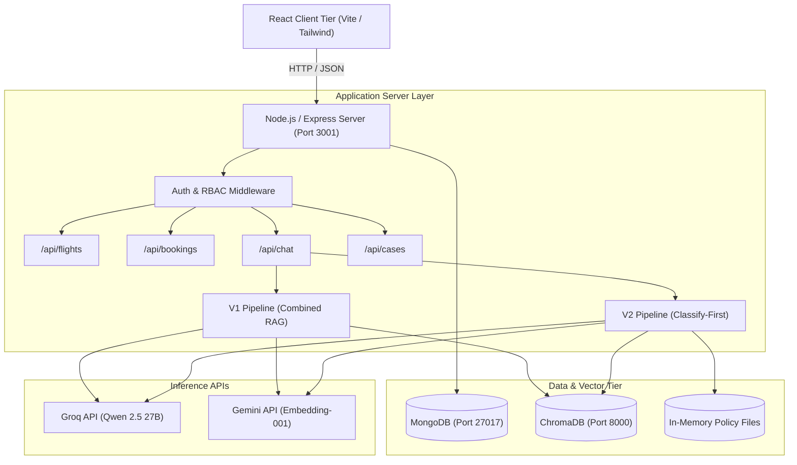

# SYSTEM DESIGN DOCUMENT (SDD)
## Classify-Then-Retrieve Architecture & Travel QA Application

---

## 1. Introduction

### 1.1 Purpose
This System Design Document details the high-level architecture, module decomposition, data models, algorithm specifications, and interface structures for the **Travel Support QA System**.

---

## 2. System Architecture & High-Level Design

### 2.1 3-Tier Enterprise Architecture
The system follows a classic 3-tier decoupled web architecture:
1. **Tier 1 (Presentation):** React 18 Single Page Application running Vite, React Router v6, and Tailwind CSS.
2. **Tier 2 (Application & Logic):** Node.js runtime executing Express REST endpoints, authentication middleware, prompt engineering modules, and dual QA pipelines (V1 and V2).
3. **Tier 3 (Data & Inference):**
   - **ChromaDB:** Local vector database container running HNSW indexing with cosine space.
   - **MongoDB 7.0:** Persistent document database for user profiles, flights, bookings, support cases, and experiment telemetry.
   - **External Inference APIs:** Groq Cloud API (`qwen/qwen3.8-27b`) and Google Gemini API (`gemini-embedding-001`).



---

## 3. Data Models & Database Schema

### 3.1 MongoDB Collections

#### 1. `users` Collection
Stores registered travelers and support staff personnel.
```json
{
  "_id": "ObjectId",
  "name": "string",
  "email": "string (unique)",
  "passwordHash": "string (bcrypt)",
  "role": "string ('customer' | 'agent')",
  "customerId": "string (unique, e.g., 'cust_101')",
  "createdAt": "date"
}
```

#### 2. `flights` Collection
Stores scheduled flights for booking and search operations.
```json
{
  "_id": "ObjectId",
  "flightNumber": "string (unique, e.g., 'VJ-202')",
  "airline": "string",
  "origin": "string",
  "destination": "string",
  "departureTime": "date",
  "arrivalTime": "date",
  "price": "number",
  "totalSeats": "number",
  "availableSeats": "number"
}
```

#### 3. `bookings` Collection
Stores confirmed flight reservations.
```json
{
  "_id": "ObjectId",
  "bookingReference": "string (unique, e.g., 'BK-892145')",
  "userId": "ObjectId (ref: users)",
  "customerId": "string",
  "flightId": "ObjectId (ref: flights)",
  "flightNumber": "string",
  "passengers": [
    { "name": "string", "passportNumber": "string", "seat": "string" }
  ],
  "totalAmount": "number",
  "status": "string ('confirmed' | 'cancelled')",
  "bookedAt": "date"
}
```

#### 4. `cases` Collection
Stores customer support inquiries escalated by V1 or V2.
```json
{
  "_id": "ObjectId",
  "caseNumber": "string (unique, e.g., 'CASE-1001')",
  "customerId": "string",
  "customerName": "string",
  "question": "string",
  "system": "string ('V1' | 'V2')",
  "classification": "string ('OKF_ONLY' | 'RAG_ONLY' | 'HYBRID' | 'ESCALATE' | null)",
  "escalationReason": "string ('INSUFFICIENT' | 'CONFLICT' | 'CLASSIFIER_ESCALATE' | 'NO_OKF_MATCH' | 'NO_RAG_MATCH')",
  "retrievedEvidence": [
    { "type": "string ('OKF' | 'RAG')", "id": "string", "text": "string" }
  ],
  "status": "string ('open' | 'resolved')",
  "staffReply": "string | null",
  "resolvedBy": "ObjectId | null (ref: users)",
  "resolvedAt": "date | null",
  "createdAt": "date"
}
```

#### 5. `experiment_logs` Collection
High-volume telemetry collection recording all evaluation runs.
```json
{
  "_id": "ObjectId",
  "runId": "string (e.g., 'test-frozen')",
  "questionId": "string",
  "split": "string ('dev' | 'test')",
  "system": "string ('V1' | 'V2')",
  "rep": "number",
  "kind": "string ('eval' | 'timing')",
  "outcome": "string ('ANSWERED' | 'ESCALATED')",
  "answer": "string | null",
  "escalationReason": "string | null",
  "classification": "string | null",
  "citations": ["array"],
  "retrieved": ["array"],
  "classifyMs": "number",
  "retrievalMs": "number",
  "llmMs": "number",
  "tokens": {
    "prompt": "number",
    "completion": "number",
    "total": "number"
  },
  "grade": {
    "correct": "boolean",
    "failureType": "string | null",
    "notes": "string"
  },
  "createdAt": "date"
}
```

---

## 4. Pipeline & Component Specifications

### 4.1 V1: Monolithic Vector Pipeline
- **Vector Space:** Chroma collection `combined` with 48 items (18 full markdown files + 30 notices).
- **Embeddings:** Generated via `gemini-embedding-001` with cosine metric space.
- **Retrieval:** $K=3$ nearest neighbors.
- **Prompt Assembly:**
  ```text
  You are a travel agency support assistant.
  Answer the customer's question using ONLY the evidence below.
  ...
  Evidence:
  [OKF:filename.md]
  ...
  [RAG:notice-0001]
  ...
  Question: {question}
  ```

### 4.2 V2: Classify-Then-Retrieve Pipeline
- **Zero-Shot Routing:** Uses frozen `buildClassifyPrompt(question)`.
- **Targeted Retrieval Matrix:**
  - `OKF_ONLY`: Executes deterministic lexical keyword matcher over 18 policy files, selecting the single top-scoring file.
  - `RAG_ONLY`: Executes dense vector query against dedicated collection `notices` ($K=3$), enforcing $s \ge 0.3$.
  - `HYBRID`: Executes both OKF lexical matcher (top 1) and vector search (top 3 with $s \ge 0.3$).
  - `ESCALATE`: Skips retrieval immediately; returns `outcome: "ESCALATED"` and `escalationReason: "CLASSIFIER_ESCALATE"`.
- **Multi-Factor Escalation Decision Tree:**
  - If classifier returns `ESCALATE` $\rightarrow$ Escalate (`CLASSIFIER_ESCALATE`).
  - If classifier returns unrecognized string $\rightarrow$ Escalate (`CLASSIFIER_INVALID`).
  - If OKF keyword score is 0 $\rightarrow$ Escalate (`NO_OKF_MATCH`).
  - If all notice similarities $< 0.3$ $\rightarrow$ Escalate (`NO_RAG_MATCH`).
  - If generator LLM emits `INSUFFICIENT` $\rightarrow$ Escalate (`INSUFFICIENT`).
  - If generator LLM emits `CONFLICT` $\rightarrow$ Escalate (`CONFLICT`).

---

## 5. Security & Verification Design

### 5.1 HTML Comment Sanitization
All policy markdown files are ingested via `okfLoader.js`, which applies the regular expression:
```javascript
const sanitizedBody = rawMarkdown.replace(/<!--[\s\S]*?-->/g, '').trim();
```
This guarantees that internal notes and corrections embedded in stale documents are never exposed to embedding models or generator prompts.

### 5.2 Deterministic Caching Architecture
All external LLM and embedding calls pass through caching wrappers:
- `cache/llm-cache.json`: Keys are SHA-256 hashes of `(model, prompt, temperature)`.
- `cache/embed-cache.json`: Keys are SHA-256 hashes of `(model, text)`.

This guarantees that benchmark evaluations are completely reproducible without consuming redundant cloud tokens.

